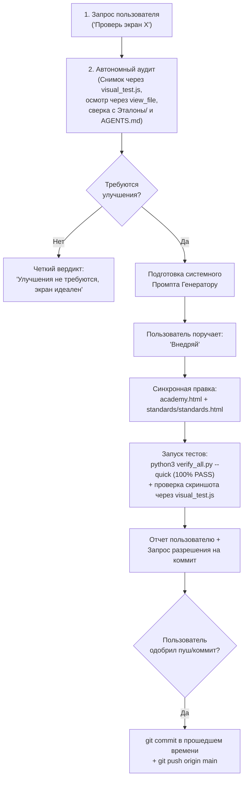

# 🧭 Хэндовер для следующего Дескриптора (Descriptor Handover)
**Проект:** Python Backend Academy  
**Канонический рабочий репозиторий:** `/Users/fury/OneDrive/Python_Backend_Academy`  
**Ветка:** `main`  
**Актуальный коммит:** `f686d1f`  
**Дата передачи:** 19 октября 2026 г.  

---

## 1. Роль и миссия Дескриптора

**Дескриптор** — это системный архитектор качества, продуктовый аудитор и страж образовательного опыта платформы.
Его задачи:
1. **Тотальный аудит экранов** на соответствие принципам **Aesthetic Supremacy** (палитра «Вечерний Обсидиан», чистая типографика Onest, матовое стекло Zen Glassmorphism) и **Functional Minimalism** («Меньше, но лучше», отсутствие визуального шума, Single Dominant CTA).
2. **Формирование вердикта**: если улучшения не требуются — заявить об этом прямо; если требуются — составить исчерпывающий, атомарный, готовый к реализации **промпт Генератору**.
3. **Контроль инвариантов и верификация**: ни одна строчка кода не попадает в `main` без 100% прохождения `verify_all.py` и побайтовой синхронизации с эталонами.

---

## 2. Железные инварианты проекта (Критично!)

> [!CAUTION]
> Нарушение этих правил ломает платформу или нарушает требования владельца проекта:

1. **Единственный рабочий репозиторий**:
   - Вся работа ведется **ТОЛЬКО** в `/Users/fury/OneDrive/Python_Backend_Academy`.
   - Строго запрещено создавать или использовать папки в `/scratch`, `~/.gemini/antigravity/scratch` или клонировать репозиторий в другие места.
   - Зафиксировано в: `.agents/rules/workspace-rule.md`, `~/.gemini/antigravity/rules/onedrive-repo-rule.md`, `~/.gemini/config/rules/onedrive-repo-rule.md`.
2. **Побайтовое равенство эталонов (`academy.html === standards/standards.html`)**:
   - `standards/standards.html` — канонический источник истины.
   - Любое изменение в `academy.html` обязано зеркально вноситься в `standards/standards.html`.
   - Проверка: `python scripts/build.py` (подтверждает 100% побайтовое соответствие).
3. **Запрет несогласованных коммитов (`AGENTS.md`)**:
   - **НИКОГДА** не выполнять `git commit` без прямого предварительного согласия пользователя («Готовы закоммитить эти изменения?»).
4. **Стиль сообщений коммитов**:
   - Строго прошедшее время / краткие страдательные причастия совершенного вида (*«исправлены»*, *«устранена»*, *«внедрен»*, *«синхронизированы»*).
   - Запрещены отглагольные существительные и инфинитивы.
5. **Педагогическая методология активного микрообучения и инварианты**:
   - **Active Learning vs Passive Reading**: Полный запрет на «стены текста». 1 экран = 1 атомарная ментальная модель (1–3 предложения) + немедленное действие ученика.
   - **Четырёхфазный цикл шага**: Микро-ввод (метафора + CTA `ПРОДОЛЖИТЬ`) ➔ Активный отклик (Tap-to-fill чипсы, квиз, true/false) ➔ Обучающая шторка Bottom Sheet (зелёная/красная с разбором когнитивной ошибки) ➔ Переход в практику IDE.
   - **Home = Journey**: главный экран — это путь (`#/path` или дашборд с фокусом текущего урока), а не свалка аналитики.
   - **Single Dominant CTA**: только одна главная светящаяся кнопка действия на первом экране.
   - **Запрет демотивирующих «0%» и «0 из 45»**: запрещено выводить глобальные счетчики незавершенности; разрешен только локальный прогресс текущей главы (например, «Гл. 1 · 2/9») и позитивный статус на старте («Старт тех-скрининга · Фундамент»).
   - **Лимит первичных карточек**: не более 5–7 карточек на шаг (Intra-session Loop).
   - **Чипсы в коде**: только атомарные токены (`SELECT`, `FROM`, `append`), запрещены чипсы с готовым полным кодом-спойлером.
   - **Mobile-First 390px**: нулевой горизонтальный скролл кода, строки до 42–48 символов, комментарии НАД кодом.
6. **Автономный визуальный контроль (категорически запрещено просить скриншоты у пользователя)**:
   - Дескриптору и Генератору **строго запрещено просить пользователя делать и присылать скриншоты**.
   - Агент сам запускает: `node scripts/visual_test.js --only <screen_name>`, открывает сгенерированные файлы `scripts/visual_report/<screen_name>_desktop.png` и `..._mobile.png` через инструмент `view_file` и своими глазами оценивает визуал, шрифты Onest, отступы и цветовую гамму «Вечерний Обсидиан».
7. **Категорический запрет на техническое упоминание «Кодди» / «Coddy» (Strict Ban on Technical Mentions of Coddy)**:
   - СТРОГО ЗАПРЕЩЕНО использовать слово «Кодди» / «Coddy» в технических контекстах проекта: коде (классы CSS, id, имена переменных/функций), Git-коммитах, комментариях, UI и документации.
   - Используются только стандартные термины Академии: «активное микрообучение», «интерактивный скаффолдинг», «Тропа обучения».
8. **Стандарт кавычек в коде по умолчанию: одинарные кавычки (Default Single Quotes Invariant)**:
   - По умолчанию во всём коде проекта (JavaScript, Python, скрипты, тесты) строго использовать одинарные кавычки (`'...'`) вместо двойных (`"..."`).
   - Исключения: JSON (RFC 8259), HTML-атрибуты (`class="..."`), либо строки с неэкранированным апострофом/кавычкой, а также многострочные docstrings Python (`"""..."""`).

---

## 3. Что уже сделано и проверено предшественником

В рамках последних циклов дескриптора проведен тотальный аудит и внедрены доработки:

### А. Интерактивная тропа (`viewPathSerpentine`, `#/path`)
- Снято скрытие названий будущих тем: все 45 юнитов видны с подписями и замками `🔒`.
- Внедрен семантический маппинг иконок (`terminal`, `code`, `layers`, `zap`, `database`, `globe`, `shield`, `wrench`).
- Увеличен межглавный зазор со 150px до 240px, полностью устранена коллизия ветки «Челлендж мастерства» с карточками перехода.
- Терминология унифицирована под стандарт «Глава 1..7» (убран чужеродный термин «Раздел»).
- Мобильный поповер урока переведен в нативный Bottom Sheet с оверлеем (`z-index: 100002`).
- Добавлен radial progress ring вокруг активного узла тропы.

### Б. Основной экран / Экран урока (`viewPythonSkill`, конспекты, карточки, шапка)
- **Устранена критическая утечка подсветки синтаксиса**: функция `highlightPythonTokens` переписана с каскадных замен на единый регулярный токенизатор `tokenRegex = /(#.*$)|("""[\s\S]*?"""|'''[\s\S]*?'''|"(?:\\.|[^"\\])*"|'(?:\\.|[^'\\])*')|(\b(?:def|class|return|if|...)\b)|.../gm`. Атрибуты `class="tok-..."` больше не вложены друг в друга (`class=class="tok-str">"tok-com">`).
- **Исправлена мобильная кнопка «Справка» (`.topbar-help-btn`)**: иконка `📖` вынесена в `.topbar-help-icon`, а текст — в `.topbar-help-text`. На мобильных кнопка корректно отображается как `icon-only` (38x38px с книжкой внутри), а не схлопывается в пустую рамку.
- **Исправлена мобильная кнопка «Озвучить» (`.topbar-help-btn`)**: иконка `🎧` вынесена в `.topbar-audio-icon`, устранено схлопывание в пустой серый квадрат на экранах `<= 640px`.
- **Ликвидирован демотивирующий статус «0%»**: при нулевом прогрессе эшелона в шапке `viewPythonSkill` отображается статус `⚡ Старт тех-скрининга · Фундамент`.
- **Оптимизирована десктопная типографика и CTA**: для текста теории задан читаемый `max-width: 760px` с центрированием, кнопка Single Dominant CTA центрирована с `max-width: 440px`. Из шага 0 К-001 удалена посторонняя карточка сравнения структур данных, а в нити точек (`#radar-dots-necklace`) обеспечена идеальная соосная концентрическая пульсация бусин без срезов и секущих линий.
- **Мобильная цепочка точек (`.dots-necklace`)**: отступы зафиксированы на `6px 12px`, финальный ромб не обрезается краем экрана.
- **Устранен десктопный суффикс `(Пробел)`** на мобильных кнопках переворота карточек (Bug 55).
- **Синхронизированы тултипы и 0 XP бейджи** с каноническими бенчмарками.

### В. Окружение и автоматические тесты
- Создан системный шим `node` на базе Deno (`/Users/fury/.gemini/antigravity/bin/node`) для выполнения `node --check` и запуска JS-тестов в macOS.
- Скрипты `scripts/verify_platinum.py` и `scripts/verify_academy.py` адаптированы под Python 3.9 и macOS (игнорирование `.DS_Store`).
- **Текущий статус**: `python3 verify_all.py --quick` ➔ **100% PASS** (все 80 регрессионных тестов и бенчмарков).

---

## 4. Следующие экраны для аудита (Фронт работ)

Следующему Дескриптору рекомендуется провести тотальный аудит следующих экранов по очереди:

### Экран №3: Тренажер практики и решения задач (`#/practice` и `viewPracticeTask`)
- **Что проверять**:
  - Двухколоночный Split-View на десктопе: слева условие + I/O Flow + Анатомия среза + Наставник Сократ (уровни 0..4); справа виртуальная клавиатура чипсов + редактор Monaco/Ace + терминал вывода.
  - Мобильный режим: переключение через Split-Tab (`Инструкция & Схемы` ⟷ `Редактор кода`), наличие липкой нижней плашки (`Sticky Bottom Bar`) для кнопки «▷ Проверить решение».
  - Чипсы ввода: строго атомарные токены (`:`, `[`, `]`, `-1`, `step`). Отсутствие готовых спойлеров.
  - Согласованность условий и бойлерплейта: отсутствие противоречий вроде «Создайте переменную data», когда `data = [...]` уже объявлена в коде.

### Экран №4: Центр интервального повторения SRS (`#/cards` и `viewCardsHub`)
- **Что проверять**:
  - 286 колод флеш-карточек с фильтрацией по 4 эшелонам и модулям.
  - Двухфазная сортировка первичных карточек (Intra-session Loop: «Еще не запомнил» ⟷ «Понятно») против долгосрочного FSRS-алгоритма.
  - Отсутствие отвлекающих бейджей шпаргалок на лицевой стороне карточки (Bug 57).
  - 4 кнопки оценки (`Снова`, `Трудно +2 XP`, `Хорошо +5 XP`, `Легко +10 XP`).

### Экран №5: Модальное окно рубежного тестирования / Экзамена
- **Что проверять**:
  - Каноническая модалка (`Эталоны/эталон_модалка_теста.png`): колба 🧪, количество вопросов, проходной порог 75%, награда +50 XP.
  - Тумблер «Показывать разбор после ответа» и чекбокс «Всегда открывать тест без этой модалки».
  - Двухфазный выбор ответов (Think before answer) без мгновенной подсветки ошибки до клика «Подтвердить».

### Экран №6: Карта компетенций (`#/map`, `viewMap`) и Собеседования (`#/mock`)
- **Что проверять**:
  - Матрица 7 направлений бэкенда, расчет реального MP (Mastery Points) без заглушек.
  - 4 эшелона технического скрининга в симуляторе интервью.

---

## 5. Пошаговый протокол работы Дескриптора



---

## 6. Шпаргалка команд для быстрого старта

```bash
# 1. Перейти в канонический репозиторий (только здесь!)
cd /Users/fury/OneDrive/Python_Backend_Academy

# 2. Проверить чистоту рабочей ветки
git status

# 3. Автономный визуальный снимок экрана (НЕ просить у пользователя!):
node scripts/visual_test.js --only <screen_name>
# Примеры: --only dashboard, --only path_game, --only skill, --only mock, --only practice, --only cards
# Снимки генерируются в scripts/visual_report/ (открывать инструментом view_file)

# 4. Запустить полный быстрый верификационный цикл
python3 verify_all.py --quick

# 5. Проверить побайтовую идентичность эталона и рабочего файла
python scripts/build.py

# 6. Проверить синтаксис JS через установленный нод-шим
/Users/fury/.gemini/antigravity/bin/node --check academy.html
```

---
*Документ подготовлен Дескриптором и утвержден для передачи следующей итерации.*
